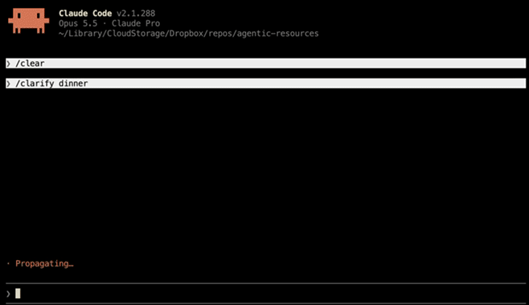

# Decide

**Decisions: Fast. Thorough. Concise.**

## 💡 Why Decide Exists
The Decide skill facilitates fast decisions through iterative questions and suggested answers. [Compared to skills like grill-me](#challenges-of-grill-me): 2-4x faster decision speed at similar thoroughness, 2-4x faster decision reading comprehension, and improved group usability.

The below example took 3 minutes and 17 keystrokes using Opus 5.5.

## Examples

Notation: `?` question, `.` answer, `+` pro, `-` con, `*` decision.

```txt
> /decide dinner

... 3 minutes and 17 keystrokes later:

What should I do about dinner?
    * cook at home
        + no travel with kids
        - cleanup
        - prep time
        Assumptions?
            . you have ingredients for a meal on hand
            . you would cook
            . control over ingredients won't change decision
            . leftovers for later meals won't change decision
    . eat out
        + no cleanup
        + no prep time
        - travel with kids
        Assumptions?
            . you have a kid-friendly restaurant in mind
    Who is eating?
        . family with kids
            How many people are eating?
                . 4
            Assumptions?
                . kids are old enough to sit through a restaurant meal
                . family has no dietary restrictions
                . kids will eat ordinary family meals
    Assumptions?
        . time allows cooking at home or eating out
        . eating out costs more than cooking at home
```
---


## Installation

### Installing in ChatGPT
<https://help.openai.com/en/articles/20001066-skills-in-chatgpt>

### Installing in Claude
<https://support.claude.com/en/articles/12512180-use-skills-in-claude>

### Installing from Terminal
npx: `npx skills add https://www.a-laughlin.com/agentic-resources --skill decide -a claude-code -g`\
pnpm: `pnpm dlx skills add https://www.a-laughlin.com/agentic-resources --skill decide -a claude-code -g`\
Claude plugin: `claude plugin marketplace add a-laughlin/agentic-resources` then `claude plugin install decide@agentic-resources`\
gh: `gh skill install a-laughlin/agentic-resources decide`\
curl: `curl -fsSL --create-dirs https://www.a-laughlin.com/agentic-resources/agent-skills/decide/SKILL.md -o ~/.claude/skills/decide/SKILL.md`\
--\
Swap `-a claude-code | ~/.claude/skills` for your agent (e.g.`cursor`, `~/.cursor/skills`, `~/.agents/skills`, …).

## Common Decision Tasks

Once the Decide skill is installed, in your AI chat type: `/decide x`, where `x` can be problems, solutions, questions, ideas, anything.

### Task - Framing the Decisions
Decide classifies your input as problems, solutions, or context.
- Questions keep their structure: `/decide What should I do next?` → `What should I do next?`
- Problems are rephrased as root questions: `/decide next` → `What should I do next?`
- Solutions are interactively traced to needs they meet, then kept as an option: `/decide order pizza` → <inquiries> → `What should I do about my hunger? 1. order pizza 2. others...`
- Context is recorded under a `Context?` question: `/decide next action, I'm hungry` → `What should I do next? <suggestions> Context? . I'm hungry`

### Task - Select from Suggestions
Given:
```txt
What should I do for dinner?
    1 . cook at home
    2 . eat at a restaurant
    3 ? Who is eating?
---

Type "123 11": keep "1,2,3,11", "d12": decide "1,2", "e12": explain "1,2", ".": all
     "=[?]": more, "-[?]": more general, "+[?]": more specific, "defer", "tree", or ____.
```

`.` selects all suggestions.\
`12` selects suggestions #1 and #2 to explore their pros/cons before deciding. Also documents an assumption for skipped question #3.\
`12 and doordash` selects suggestions #1 and #2 and adds a "doordash" answer. Also documents an assumption for skipped question #3.

Selected questions are answered sequentially, then unselected suggestions are refreshed. When no questions are selected, guessed answers to remaining questions get added to "Assumptions".

### Task - Explain Unfamiliar Suggestions before Deciding
`e12` explains suggestions 1,2 and their pros/cons

### Task - Decide Suggestions
`d12` decides suggestions 1,2 (marks them as decisions), and documents an assumption for skipped question #3

### Task - Add Suggestions
`=` more suggestions\
`=?` more question suggestions

### Task - Improve Suggestions
`+` more specific suggestions\
`+?` more specific questions\
`-` more general suggestions\
`-?` more general questions\
Or just type how suggestions should differ (e.g., more concrete, exclude complicated)

### Task - Defer a Question for Later without Interrupting Flow
`defer` postpones the question to revisit when you choose (adds `(user-deferred)`)

### Task - Show Broader Context
`tree` shows the full decision tree so far, in case the currently shown context is insufficient

### Task - Everything Else
`___` free-form type to change suggestions, presentation, or the existing tree.

## Challenges (of grill-me)
While using Matt Pocock's [grill-me skill](https://github.com/mattpocock/skills/blob/main/skills/productivity/grilling/SKILL.md), I began to notice extraneous cognitive load and other challenges that slowed me down:
- **Scannability:** Paragraphs of free-form text and inline suggestions are slow to scan vs lists.
- **Consistency:** The default skill sometimes outputs lists to choose from, sometimes not. The inconsistent formatting creats unpredictability that slows down entry and comprehension speed.
- **Traceability:** Untyped suggestions and assumptions go unrecorded, leaving no trace for decision records and specs.
- **Shareability:** The linear Q# format and spacing are too verbose and indirect for practical usage in decision records and specs.
- **Understandability:** Questions paragraphs mix suggestions, pros, cons, and sub-questions inconsistently, slowing reasoning about the tree. The linear+batch format obscures tree relationships. Question batches overflow the visible window and require scrolling. "Q#" indexes + batching require remembering numbers and mixing them with typed concepts. The default skill inconsistently outputs lists, sometimes not. All of these slow comprehension through [extraneous cognitive load](https://thedecisionlab.com/reference-guide/psychology/cognitive-load-theory).
- **Anchoring bias:** A single recommendation anchors on that option, and missing null suggestions anchor on "fixing what ain't broke".
- **Usability:** Answering by Q number takes lookups, scrolling, and typing. Good alternative suggestions show up inconsistently.

## Benefits
In addition to solving the above challenges, Decide adds a few benefits:
- Maximizes decision and exploration speed (2-4x grill-me's speed in my own tests)
- Maximizes decision reading comprehension (2-4x grill-me's speed in my own tests)
- Maximizes group usefulness [1](#footnotes)
- Maximizes decision trace sharability
- Minimizes typing
- Eases multi-session decisions and question deferral.


## Tradeoffs
One benefit of free-form paragraphs is that they support intermingling decision traces with supporting data visualizations like images and tables. If you prefer mixing alternate data formats with your decision traces, semantic decision trees like IBIS will feel awkward. I prefer separating the decision traces from their supporting resources with a references section, so free-form paragraphs vs. decision trees don't matter.


## ⚖️ Differences from Grill-me

| Aspect | Grill-Me | Decide |
| :--- | :--- | :--- |
| **Focus** | Many questions at once | One question at a time |
| **Context Structure** | Unstructured design tree | Semantically structured issue tree |
| **Context Presentation** | Unstructured paragraphs | logic paths |
| **Context Location** | Spread within and across split paragraphs | Relevant context colocated with latest question |
| **Context Finding** | Asking, remembering Q#s + scrolling + reading, ctrl+f in session history | scanning latest response, "tree" command |
| **Suggestions** | Inconsistent, unstructured | Consistent, structured, automatically suggested then confirmed and recorded |
| **Assumptions** | thinking + manual typing | Consistent, structured, automatically suggested then confirmed and recorded |
| **Responding** | "Q#" references | Hotkeys |
| **Usage Contexts** | Individual | Individual, Meetings, Decision Records, Specs |
| **Logical Conflict Resolution** | - | automated detection, suggestion, and hotkeyed resolution |
| **Pausing** | — | Defer questions, stop and resume |

## Footnotes
1. [IBIS notation](https://en.wikipedia.org/wiki/Issue-based_information_system) was designed to reach fast group decisions on problems as complex as "What should we do about climate change?". I've used it to keep meetings of 2-30 attendees on track and productive.

## 📜 Credits
- Inspired by [@mattpocock](https://github.com/mattpocock)'s [grill-me skill](https://github.com/mattpocock/skills/blob/main/skills/productivity/grilling/SKILL.md).

## 📄 License
MIT © Adam Laughlin
